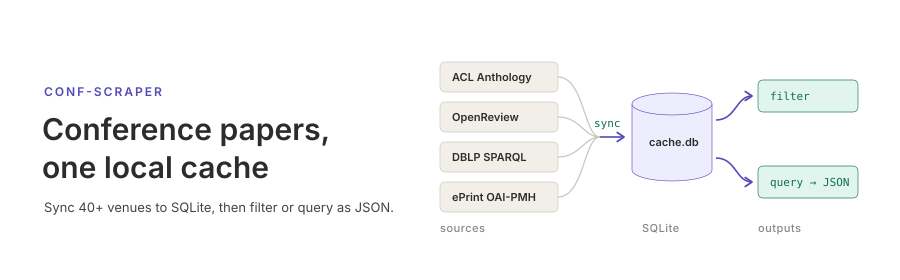

<p align="center"></p>

**English** | [日本語](README.ja.md)

# conf-scraper

`conf-scraper` collects paper metadata — title, authors, abstract, URL, PDF URL — from 45 conferences and journals in NLP, ML, CV, security, cryptography, networking, data mining, simulation and Japanese academic societies, and keeps it in a local SQLite cache. Once synced, the cache can be filtered by keyword or category, summarized, or read as JSON by other programs such as a dashboard. Each venue is fetched from the source its publisher intends for machine access (ACL Anthology XML, OpenReview, DBLP SPARQL, the IACR ePrint OAI-PMH feed, CiNii Research, …), with rate limiting and `Retry-After` handling built in.

## Install

```bash
cargo install --path .
```

## Quick start

```bash
# See which venues are supported
conf-scraper list-conferences

# Sync NeurIPS 2024 papers
conf-scraper sync --conference neurips --year 2024

# Keyword filter
conf-scraper filter --conference neurips --year 2024 \
  --filter keyword --keywords "transformer,attention"

# Venue × year catalog as JSON
conf-scraper query catalog
```

The cache lives in `~/.cache/conf-scraper` by default (`--cache-dir` changes it).

## Documentation

- [Use cases](docs/usecases.md) — building a corpus, literature surveys, dashboards, scheduled sync
- [CLI reference](docs/cli.md) — every command and option, exit status, retry behavior
- [Venues and data sources](docs/venues.md) — supported venues, where each one comes from, abstract coverage
- [Architecture](docs/architecture.md) — module layout, the sync pipeline, the cache schema, adding a venue

## License

MIT — see [LICENSE](LICENSE).
